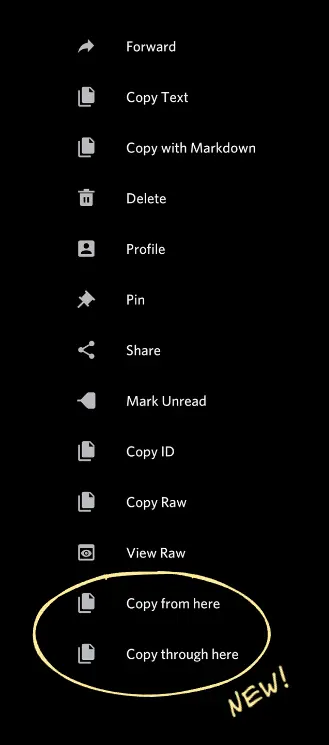

# aliucord-plugins

Plugins and notes for [Aliucord](https://github.com/Aliucord/Aliucord), the legacy Android Discord client mod.

## Layout

| Path | What it is |
| --- | --- |
| [`plugins/`](plugins/) | Plugins maintained in this repo |
| [`guide/`](guide/) | How to write Aliucord plugins, written from the material below |
| [`docs/`](docs/) | Upstream docs, template, and Gradle plugin (git submodules) |
| [`examples/`](examples/) | Widely distributed community plugin repos (git submodules) |

Built ZIPs land on the [`builds`](https://github.com/VibedByKaKi/aliucord-plugins/tree/builds) branch when CI runs on `master`.

## Plugins

### [multi-select-copy](plugins/multi-select-copy/README.md)

<table><tr><td>

Copy a contiguous range of chat messages. Long-press **Copy from here**, then **Copy through here** on another (or the same) message.

Install: download [`multi-select-copy.zip`](https://github.com/VibedByKaKi/aliucord-plugins/raw/builds/multi-select-copy.zip), put it in `Aliucord/plugins`, then restart Aliucord.

</td><td>



</td></tr></table>

### [Forked from zt64](https://github.com/VibedByKaKi/zt64-aliucord-plugins)

#### DMCategories

<table><tr><td>

Pin DMs at the top. The original hard-codes sorting by last activity, fork allows user-chosen sorting.

Install: download [`DMCategories.zip`](https://github.com/VibedByKaKi/zt64-aliucord-plugins/releases/download/dev/DMCategories.zip), put it in `Aliucord/plugins`, then restart Aliucord.

</td><td>


</td></tr></table>

## Guide

Start at [`guide/README.md`](guide/README.md). Covers setup, plugin anatomy, commands, patching, settings, reflection, build/publish, and which example repos to read for what.

## Clone

```bash
git clone --recurse-submodules https://github.com/VibedByKaKi/aliucord-plugins.git
```

If you already cloned without submodules:

```bash
git submodule update --init --recursive
```

## Build

Needs JDK 21 and an Android SDK.

```bash
./gradlew make
```

One plugin:

```bash
./gradlew :plugins:multi-select-copy:make
```

ZIP output: `plugins/<name>/build/outputs/<name>.zip`

Push to `master` runs the Deploy CI workflow, which rebuilds and updates the `builds` branch.
